# A4S · Agent For Students

面向大学生的**个人学习助手**：把课程资料变成可问答、可出题、可回顾的知识底座。

全部数据留在本机——资料、笔记、练习、报告都写进本地 SQLite，只有调用模型时才会联网。
账号、空间与小组协作也跑在本机；把 `server` 部署到一台公用机器后，还可以按需接入小组公共库与别人的知识库，服务器不在线时界面直接显示离线，功能不受影响。

它也不是「把什么功能都交给模型」：全项目只有一个由模型决定下一步的 Agent——学习计划，其余问答、出题、回顾都是可验证的固定流水线。学习计划内部由四个有限角色协作（观察 → 规划 → 审核 → 写入）；知识库体检是另一条确定性多角色流水线（巡检 → 修复建议 → 审核），不调对话模型。角色拆分的理由不是数量，而是收窄写权限、让审核独立。

> 本项目按 **SDD（规约驱动开发）** 推进：先写规约再写代码，实现与规约冲突时先改规约。
>
> - 产品规约：[docs/PRD.md](./docs/PRD.md)｜客户端/服务端边界：[docs/CLIENT_SERVER_SPLIT.md](./docs/CLIENT_SERVER_SPLIT.md)｜Agent 取舍：[docs/AGENT_DECISION.md](./docs/AGENT_DECISION.md)｜Agent 机会评估：[docs/AGENT_OPPORTUNITIES.md](./docs/AGENT_OPPORTUNITIES.md)
> - 当前版本 **v0.2.1**：13 条 P0（FR-01~FR-13）与 FR-14 学习计划、FR-15 多智能体教练、FR-16 知识库体检（含周定时体检复盘）均已落地，拆分后回归 **518 项断言全部通过**（明细见 CLIENT_SERVER_SPLIT §7）。


## 系统架构

浏览器调 `client`，`client` 复用 `shared` 内容栈读写本地 `client.db`；模型与邮件是外部依赖，公共服务端只承载身份、授权与小组公共库，可离线运行。

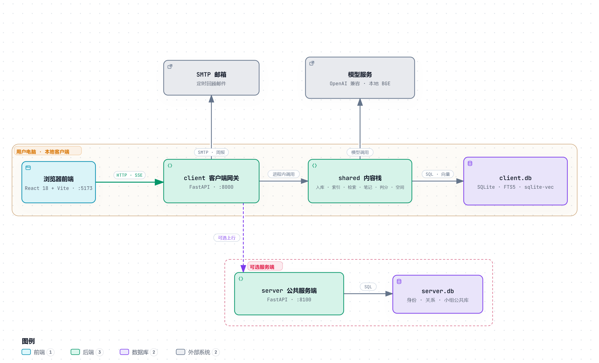

[可交互版本（支持深浅色与缩放）](./docs/architecture.html)

## 为什么叫 Agent

真正由模型决定下一步的只有导航最上面的「计划助理」。它先把目标放到一边，观察数据再决定怎么做：

1. **查**：观察员只读资料、练习、错题与主题覆盖，产出带证据的事实。
2. **想**：规划员基于事实决定缺哪块、要不要先出一套题验证。
3. **审**：审核员用确定性规则核对长度、结构与「依据」里的每个数字，不过就打回重写一次。
4. **收**：审核通过后，只有记录员能写入一份 7 天计划；不判分、不排复习日期。对外仍是最多 6 步。

页面上只按角色列出「谁做了什么」，不摊开工具原始返回；工具失败会换路，数据为空会先说明再给一份带甄别的起步计划；每次运行的完整过程都能通过 `GET /api/plan/runs/{run_id}` 回放。

「知识库」页的体检道复用同一套角色契约，但不调对话模型：巡检员逐份查解析状态、片段长度、重复与主题覆盖，并用资料原文当探针跑一次检索确认「真的问得到」；修复员只出建议，审核员丢掉没有事实依据的提案。跑完给你一张带分数的清单，不改任何资料。
判断标准与边界见 [docs/AGENT_DECISION.md](./docs/AGENT_DECISION.md) 与 [docs/PRD.md](./docs/PRD.md) FR-16。

---

## 能做什么

| 能力 | 说明 |
|---|---|
| **计划助理** | 说一句目标，助理会先查资料、练习与错题，再给出一份 7 天计划；页面顶部是资料、片段、正确率与待复习错题四项数据，右侧按角色显示执行过程 |
| **知识库体检** | 知识库页一键体检：查出 0 片段、解析失败、正文过短、重复资料、空主题与检索不到的资料，给出健康分和修复建议；只读、不调对话模型、不改资料 |
| **资料入库** | PDF / Word / Markdown / 纯文本；必选主题；支持粘贴文本与网页正文抓取；失败会给出具体原因 |
| **检索与问答** | 向量 + 全文双路召回，回答带来源角标，可点开原文片段；检索不到时不拿无关片段硬答，先声明"没有找到相关资料"，再用通用知识补答并标明"未使用你的资料"；知识库为空时也能提问，页面顶部只提示一次 |
| **电子笔记** | 从检索结果或整份资料起草，模板固定结构（章节摘要 / 概念卡 / 代码笔记 / 公式清单），草稿→定稿两态，AI 补写有标记，支持 Markdown 导出 |
| **检测题** | 单选 / 多选 / 判断 / 简答四种题型，按主题或按资料出题，每题附解析与来源 |
| **作答与判分** | 客观题自动判分，简答题自评；支持断点续答、自动保存、未答提醒 |
| **错题本** | 答错自动收录，按题目去重累加次数；按主题 / 资料 / 题型 / 时间筛选；勾选重练 |
| **回顾报告** | 聚合 7 / 14 / 30 天的资料与练习，按主题分组输出五个部分：新增资料、练习情况、错题整理、薄弱点、复习建议 |
| **定时与邮件** | 每周定时先体检知识库、再生成报告并发到邮箱；报告第六段列出体检分、问题与一句「下一步」；可关闭；失败会记录原因并在界面提示 |
| **空间与共享** | 注册即得个人空间，可另建学习小组并拉人；小组资料 / 笔记按权限共享；可把某个库只读共享给别人问答 |
| **可配置** | LLM / Embedding / SMTP 全部可在界面配置，密钥打码显示，支持「测试连接」与「发送测试邮件」 |

## 界面

| 知识库 | 笔记 |
|---|---|
| 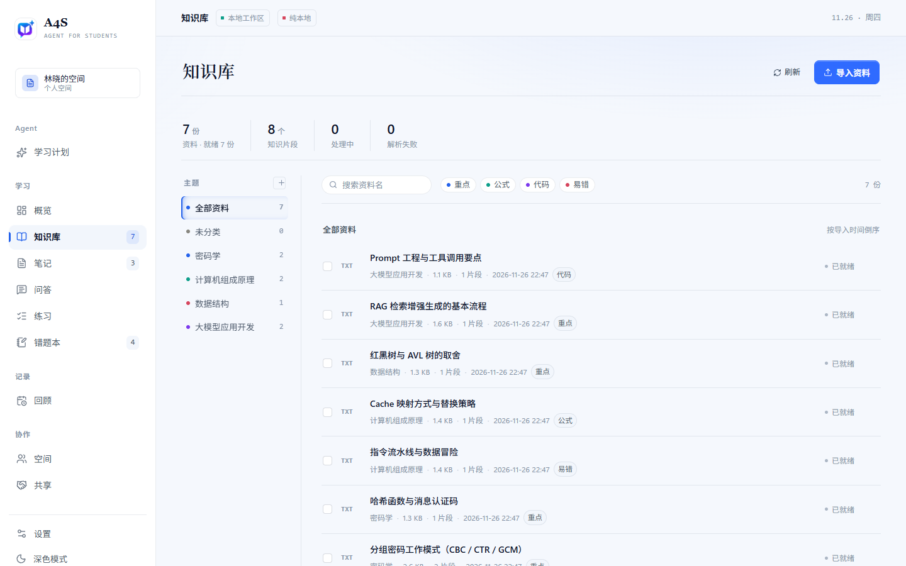 | 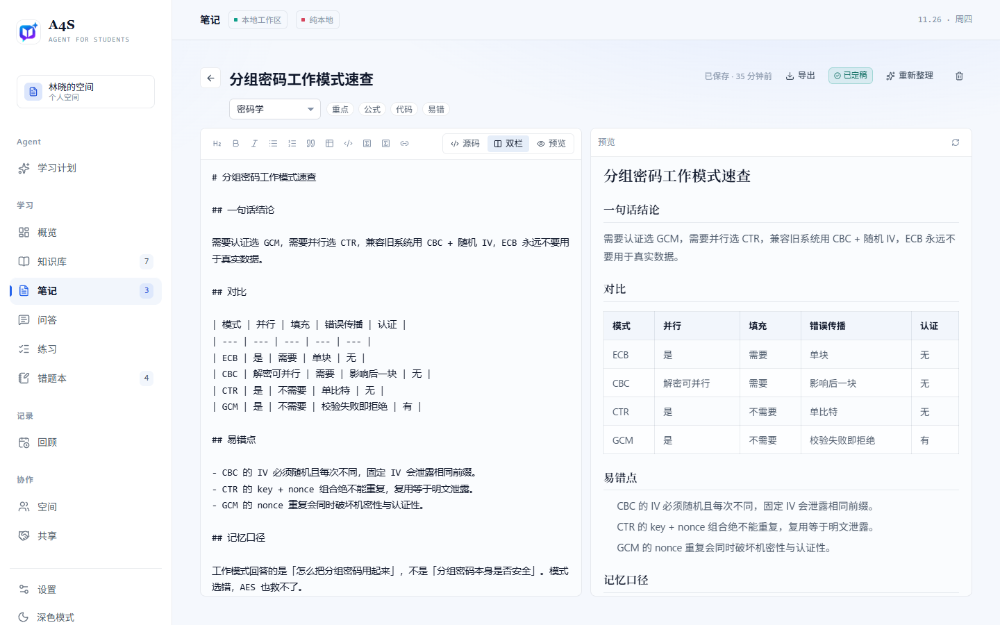 |

| 问答（带来源角标） | 练习 |
|---|---|
| 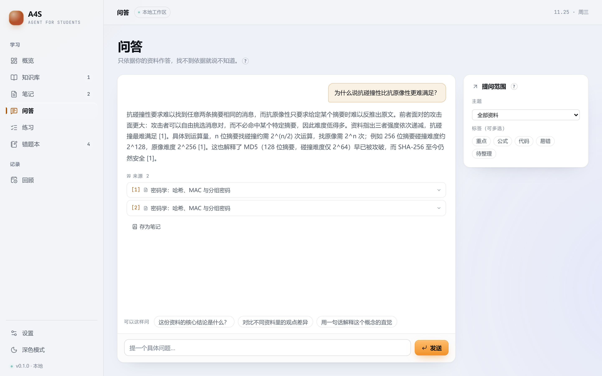 |  |

| 错题本 | 回顾 |
|---|---|
|  | 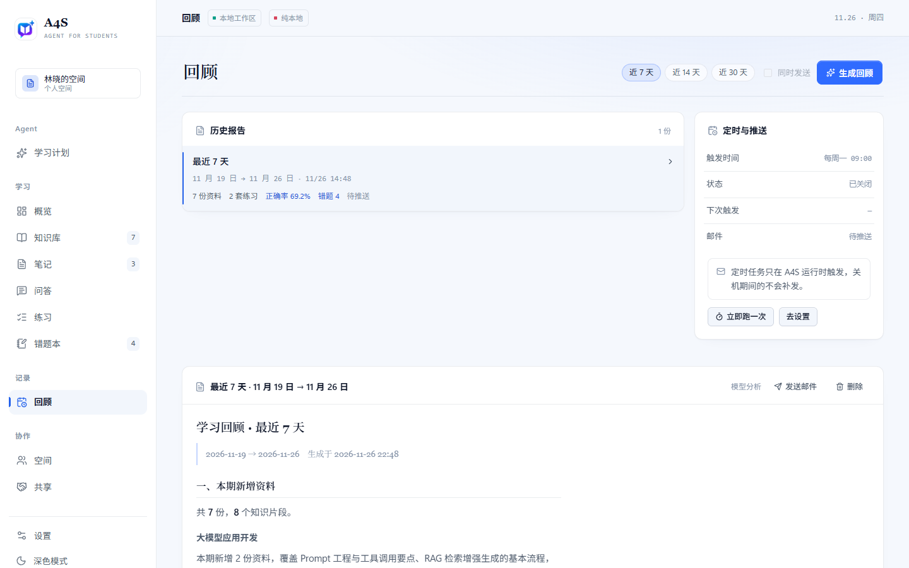 |

计划助理：顶部是资料、知识片段、练习正确率与待复习错题四项数据，主区是这次的计划，右侧按角色列出助理做了什么。

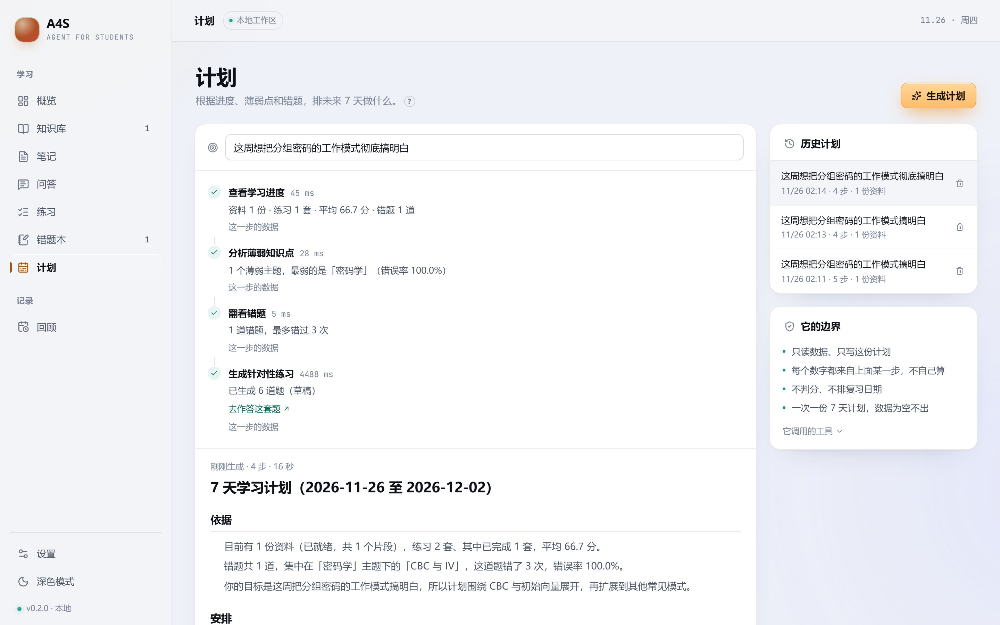

| 空间与成员 | 设置 |
|---|---|
| 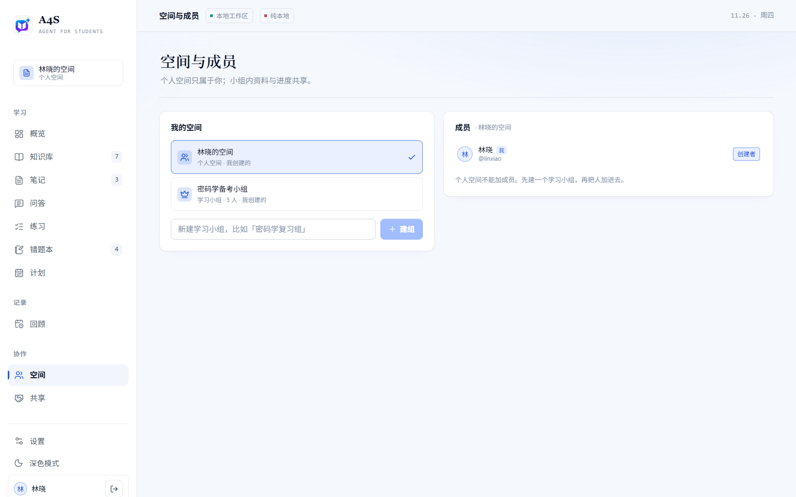 | 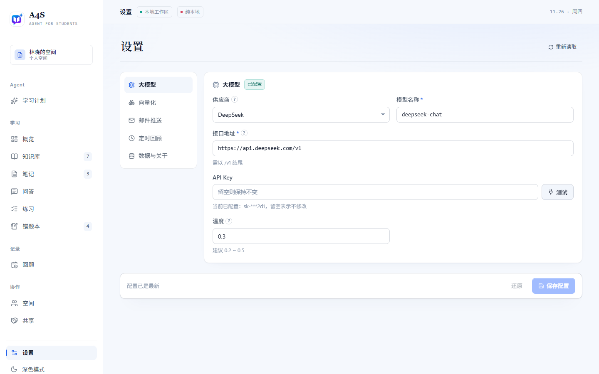 |

深色主题（默认浅色，可随时切换）：

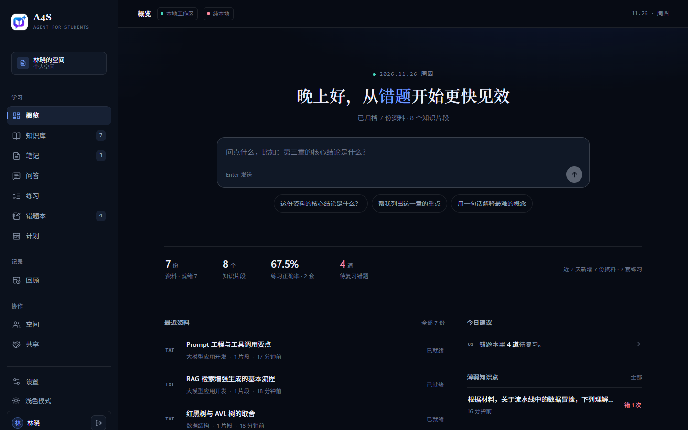

窄屏下列表与表单改为单列，侧栏收成顶部横向导航：

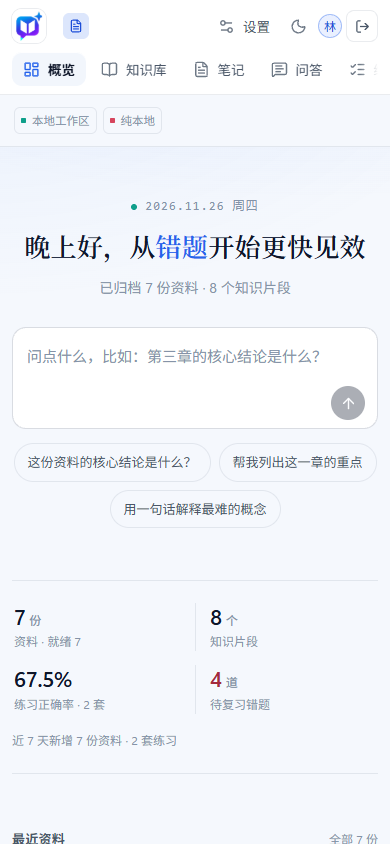

视觉与交互约定：

- **默认浅色「白盆地」**：浅蓝灰底 + 实心白面板 + 品牌蓝作唯一信号色；深色主题为深海军蓝，使用同一套令牌。
- **面板是实心的**：层次靠底色差与 1px 描边，不叠玻璃；解释性文字收进标题旁的小问号，首屏留给数据。
- **响应式**：断点 1180 / 900 / 720 / 600 / 460；宽度 ≤900 时侧栏改为顶部横向导航（≤720 折成两行），
  1600 / 1920 / 2200 以上内容区、侧栏与字号分档放大，大屏不会出现一条窄内容挂在中间。
- 正文 14.5px、元信息不低于 12px，长时间阅读不费眼。

## 账号与空间

首次打开落在登录页，注册后自动获得一个个人空间；账号与数据都在本机。

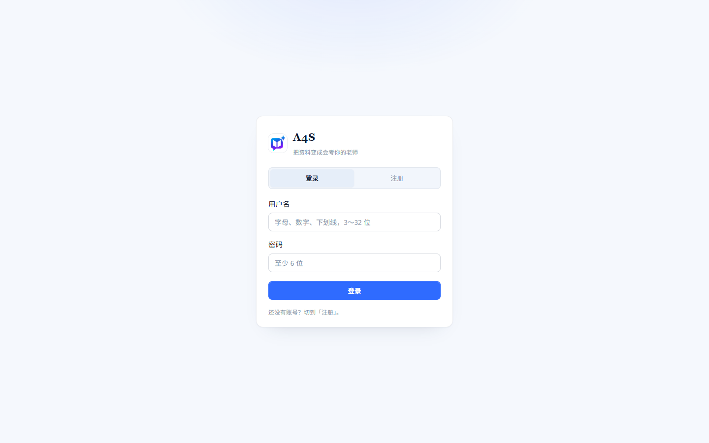

同一个「归属容器」承担两种用途，这是从 ragflow-plus 学来的做法——**团队不另建模型**：

| | 个人空间 | 学习小组 |
|---|---|---|
| 创建方式 | 注册时自动建 | 在「空间」页手动建 |
| 成员 | 只有自己 | 创建者可按用户名加人 |
| 数据 | 资料/笔记/练习/错题/计划全在里面 | 同左，组内成员共享 |
| 权限 | 不可加人、不可删 | 唯一 owner 不可移除或降级 |

几条实现上的选择：

- **主题是空间私有的**：两个小组各自都有「未分类」，所以主题表主键是 `(space_id, id)`，不是全局唯一 id。
- **隔离是 fail-closed**：所有查询都带 `space_id`（必填参数，漏传直接报错），按 id 取不到就返回 404，而不是"不限空间地给出去"。
- **token 存库不签 JWT**：为了"退出即失效"，代价是每次请求多一次 SQLite 主键查询。
- **小组投稿先审核**：member 上传的资料与笔记进入待审，owner 批准后才切分、向量化、进检索。
- **只读共享**：viewer 角色除问答外所有写接口一律 403，界面同时隐藏写按钮。

## 技术栈

| 层 | 选型 |
|---|---|
| 前端 | React 18 + TypeScript + Vite 6 + react-markdown（KaTeX / 代码高亮） |
| 后端 | Python 3.11+ / FastAPI / SQLAlchemy 2 / Alembic |
| 关系库 | SQLite（客户端与服务端各一个库文件，可切 PostgreSQL） |
| 全文检索 | SQLite FTS5 |
| 向量库 | sqlite-vec（SQLite 扩展，无独立服务进程） |
| 模型 | LLM 走 OpenAI 兼容 API（DeepSeek / 通义 / OpenAI / Moonshot）；Embedding 默认本地 BGE |
| 调度 | APScheduler（进程内，无系统级计划任务） |
| 桌面外壳 | Tauri 2（`frontend/src-tauri/`，可选；构建需要 Rust 工具链） |

## 环境要求

- Python **3.11+**（在 3.13 验证）
- Node.js **18+**（在 22 验证）
- Windows / macOS / Linux，脚本示例为 Windows

## 安装

```bash
# 1. 后端
cd backend
python -m venv .venv
.venv/Scripts/python.exe -m pip install -r requirements.txt      # 核心依赖
.venv/Scripts/python.exe -m pip install -r requirements-rag.txt  # RAG 依赖（含 torch，约 2GB，首次较慢）

# 2. 前端
cd ../frontend
npm install
```

## 配置

复制 `.env.example` 为 `.env`。最小可用配置只需 LLM 三项：

```ini
LLM_PROVIDER=deepseek
LLM_BASE_URL=https://api.deepseek.com/v1
LLM_API_KEY=你的密钥
LLM_MODEL=deepseek-chat
```

其余可全部省略，之后在「设置」页里配。配置优先级：**`.env` < 界面保存的值**，界面保存会写回 `.env`，重启后仍生效。

密钥只存在本地 `.env`，已列入 `.gitignore`，界面展示时打码（`sk-***abc`）。

可选：填 `SERVER_URL=http://<服务器>:8100` 进入联机模式，客户端会探测服务端并用 `disabled / online / offline` 三态徽标显示结果；留空为纯本地模式。

## 启动

**方式一（推荐）**：双击项目根的 `start.bat`，自动拉起前后端并打开浏览器。

**方式二（手动）**：

```bash
# 终端 1：客户端（本地应用，必须能独立跑）
cd backend
.venv/Scripts/python.exe -m uvicorn client.main:app --reload --port 8000

# 终端 2：前端
cd frontend
npm run dev

# 终端 3（可选）：公共服务端，只有需要小组公共库 / 联邦检索时才启动
cd backend
.venv/Scripts/python.exe -m uvicorn server.main:app --port 8100
```

- 前端 http://localhost:5173
- 接口文档 http://127.0.0.1:8000/docs
- 健康检查 http://127.0.0.1:8000/api/health

> 若 8000 端口被占用，uvicorn 会以 10048 静默退出。先 `netstat -ano | findstr :8000` 找 PID，再 `taskkill /F /PID <pid>`。

## 五分钟上手

0. **注册 / 登录**：首次打开会落在登录页。账号在本机创建，注册后自动获得一个个人空间。
   想和同学共用资料，就在「空间」页建一个学习小组，把对方用户名加进来。
1. **建主题**：进「知识库」，首次会提示从预置包一键创建（计算机核心 / AI 与大模型 / 数学 …），也可以自己建。
2. **导入资料**：拖入 PDF 或粘贴文本，必须选主题——主题是后续出题、错题统计、报告分组的最小单位。
3. **问一句**：进「问答」，问资料里的事。回答下方有来源角标，点开可看原文片段。
4. **做题**：进「练习」，选范围与题型数量，生成后作答。交卷即出分数与逐题回顾。
5. **看回顾**：进「回顾」选 7 天点生成。报告会告诉你哪块最弱、下一步先补什么。
6. **找助理**：侧栏最上面的「计划助理」，写一句目标（可不填），它会边查边排，过程全程可见。

## 目录结构

```
backend/
├── shared/                  # 两端共用：领域对象、模型、仓储、解析/切分/检索、账号与空间
│   ├── api/                 # 账号、空间、共享、资料、笔记、主题、概览
│   ├── services/            # 入库 / 索引 / 笔记 / 主题 / 判分 / 空间 / 共享
│   ├── infrastructure/      # db / llm / parsers / splitter / vectorstore / fts / mail
│   └── app_factory.py       # 应用工厂：建表、CORS、挂路由
├── client/                  # 本地应用（可脱离服务端运行）
│   ├── main.py              # 入口：shared + client 路由 + 调度器
│   ├── api/                 # chat / practice / review / plan / settings / server_link
│   └── services/            # 问答 / 练习 / 回顾 / 规划 Agent 与工具（agents/ 下为教练四角色 + 体检三角色）
├── server/                  # 公共服务端（只挂 shared 路由 + 联邦中继）
└── app/main.py              # 过渡兼容入口，等价于 client.main
frontend/
├── src/api/client.ts        # 全部接口封装
├── src/components/          # 布局、Toast、基础件与各业务组件
├── src/context/             # 登录态与当前空间
├── src/pages/               # 概览 / 知识库 / 笔记 / 问答 / 练习 / 错题本 / 计划 / 回顾 / 空间 / 共享 / 设置 / 登录
├── src/styles/              # tokens.css（令牌）+ base / layout / components / pages
└── src-tauri/               # Tauri 2 桌面外壳（可选）
```

> 每个目录具体管什么、一条请求怎么流过客户端，见 **[docs/CLIENT_SERVER_SPLIT.md](./docs/CLIENT_SERVER_SPLIT.md)**。

## 可替换能力

不做插件机制。每类能力由**一个工厂函数**构造，配置决定走哪个分支，业务代码不 import 具体类：

| 能力 | 工厂函数 | 现有实现 |
|---|---|---|
| 对话模型 | `build_llm()` | `deepseek` / `qwen` / `openai` / `moonshot`（全走 OpenAI 兼容协议） |
| 向量化 | `build_embedding()` | 本地 BGE（`local`/`bge`）/ 云端 API（`cloud`/`openai`） |
| 文档解析 | `resolve_parser(ext)` | PDF / DOCX / Markdown / 纯文本 |
| 出题 | `LLMTypedGenerator(type)` | 单选 / 多选 / 判断 / 简答 |
| 邮件推送 | `build_notifier()` | SMTP |

`/api/health` 的 `extensions` 字段会直接回显各扩展点的已注册键。

## 测试

每个里程碑都有独立冒烟脚本，跑在各自的临时库上，不碰开发库。拆分后回归合计 **518 项断言**：

```bash
cd backend
.venv/Scripts/python.exe scripts/smoke_m2.py      # 资料入库与索引（22）
.venv/Scripts/python.exe scripts/smoke_m25.py     # 电子笔记（46）
.venv/Scripts/python.exe scripts/smoke_m3.py      # 问答与检索范围（31）
.venv/Scripts/python.exe scripts/smoke_m4.py      # 出题（61）
.venv/Scripts/python.exe scripts/smoke_m4b.py     # 作答判分与错题本（84）
.venv/Scripts/python.exe scripts/smoke_m5.py      # 回顾报告、定时推送与周体检（56）
.venv/Scripts/python.exe scripts/smoke_m6.py      # 设置与索引（43）
.venv/Scripts/python.exe scripts/smoke_m7.py      # 学习计划多智能体（69，--real 走真实模型）
.venv/Scripts/python.exe scripts/smoke_m8_health.py  # 知识库体检道（38）
.venv/Scripts/python.exe scripts/smoke_rag.py     # 混合检索与空间隔离（18）
.venv/Scripts/python.exe scripts/smoke_auth.py    # 账号 / 空间隔离 / 小组权限（31）
.venv/Scripts/python.exe scripts/smoke_share.py   # 共享授权与只读保护（32）
```

另有拆分与协作链路的专项脚本：`smoke_p15_review.py`（投稿审核）、`smoke_p2_catalog.py`（公共目录）、
`smoke_p4_backup.py`（备份）、`smoke_p4_ui_contract.py`（前端契约）、`integration_p3_federation.py`（三进程联邦）。

探针召回另有 8 个单元测试（标准库 `unittest`，桩掉片段仓储与检索，不连库、不加载 Embedding），不计入上面的冒烟断言：

```bash
cd backend
.venv/Scripts/python.exe -m unittest discover -s tests -v
```

`smoke_m7.py` 校验学习教练的四角色边界：空库先提示再给起步计划、角色交接与步数上限、审核拦截短计划与无出处数字、
`agent_runs` / `agent_steps` 可回放、工具报错继续换路、页面关闭后无后台残留。
体检报出资料问题后，下一次计划会多一步「读取知识库体检」，把高危 / 中危问题并进依据；体检没跑过则不受影响。
`smoke_m8_health.py` 校验体检道：空库给 0 分、各类问题都能报出、可问答性探针能命中也能报出未召回、Embedding 不可用时探针跳过不误报、建议可对回问题、体检不改资料、空间隔离。
定时任务先体检再复盘：`smoke_m5.py` 额外校验每个空间都会产生一条 `trigger=schedule` 的体检、回顾含「六、资料体检」与「下一步」、列表带体检分。

## 数据库迁移

开发环境启动时自动执行 `alembic upgrade head`。客户端与服务端各有一个库文件，同一条迁移链分别 upgrade：

```bash
cd backend
.venv/Scripts/alembic revision --autogenerate -m "描述"
.venv/Scripts/alembic upgrade head
```

从旧版升级时先跑一次数据迁移（把 `app.db` 搬到 `client.db`，原库归档可回滚）：

```bash
.venv/Scripts/python.exe scripts/migrate_split_db.py --dry-run
.venv/Scripts/python.exe scripts/migrate_split_db.py
```

切换 PostgreSQL 只需改 `.env` 的 `DATABASE_URL`，业务代码不动（仓储层已做方言隔离）。

## 常见问题

**Q：`/api/health` 里 `llm_configured: false`？**
`.env` 没填 `LLM_API_KEY`。填完重启后端，或直接在「设置」页填并点「测试连接」。

**Q：出题 / 生成回顾很慢？**
它们都在等模型。出题约 20~60 秒（走后台任务 + 轮询），回顾约 10~30 秒（同步返回，界面有明确的生成中状态）。模型慢不是卡死，别重复点。

**Q：生成回顾报「材料不足」？**
出题有下限：题目数 × 100 字，不够会直接告诉你「现有 X 字 / 需要 Y 字」，不会降级出烂题。加资料或减题量即可。

**Q：邮件发不出去？**
先用「发送测试邮件」，它会真的发一封。常见原因：用了登录密码而不是 **SMTP 授权码**；465 端口要开 SSL、587 端口要关 SSL 走 STARTTLS。失败原因会写在提示里，报告不会丢。

**Q：定时任务关机后会补发吗？**
不会。v0.1 起就不注册系统计划任务，应用未运行时不会触发（补发列为 P1）。想在启动时立刻补一份，去「回顾」点「立即跑一次」；这一次会先体检再生成报告。

**Q：换 Embedding 模型后检索结果不对？**
维度不一致时索引会失效。设置页会提示，并在「索引」里提供重建入口，重建会重新向量化全部片段。

**Q：顶栏显示「服务器离线」有影响吗？**
没有。个人资料、问答、练习、笔记、计划全部在本地客户端完成；只有小组公共库与联邦检索需要服务端，离线时这些入口会给出明确提示。

## 已知限制

- **扫描版 PDF 无 OCR**：纯图片 PDF 解析出来是空的，会明确报错而不是塞进空片段。
- **简答题不自动判分**：只看自评「掌握 / 未掌握」。本地模型判主观题不可靠，宁可不判。
- **账号只在本机**：没有云端身份体系，换一台机器需要重新注册；`server` 端的小组库是另一套独立数据。
- **笔记不回灌知识库**：笔记是学习产物，不参与检索，避免「自己写的话被当成资料引用」。
- **定时任务不持久**：进程内调度，重启后按配置重新装载，关机期间不补发。
- **模型输出需容错**：所有解析路径都有校验（来源编号白名单、答案归一化、JSON 容错），但极端情况下可能少出几道题。
- **计划不做后台常驻**：规划 Agent 一次会话出一份计划，关掉页面就停，不会自己继续跑；只做 7 天粒度，没有月/季度规划（数据撑不住）。
- **桌面外壳未在本机构建**：Tauri 2 骨架与步骤已就位（`frontend/src-tauri/BUILD.md`），当前环境缺少 Rust 工具链，`tauri dev/build` 未实测。
- **移动端是响应式适配**：窄屏可用，但没有独立的移动 App，也不做手势与离线缓存。

## 版本状态

**v0.2.0**：客户端/服务端拆分（P0→P4）完成，账号 / 空间 / 小组投稿审核 / 共享 / 公共目录 / 联邦检索 / 备份全部落地；
FR-14 学习计划补齐「接下来做什么」，拆分后回归 507 项断言全过。
**v0.2.1**：教练道升级为有限多智能体；知识库体检上线（含探针召回），周定时任务改为「先体检、再复盘」，体检结论进入回顾第六段；问答与计划不再因「库是空的」拒答，改为先声明再作答；回归 518 项断言。

后续迭代方向：OCR、间隔重复排期（SM-2 / FSRS）、补发机制、笔记回灌、错题转笔记、题型自定义、日历排期、L1 插件协议。
