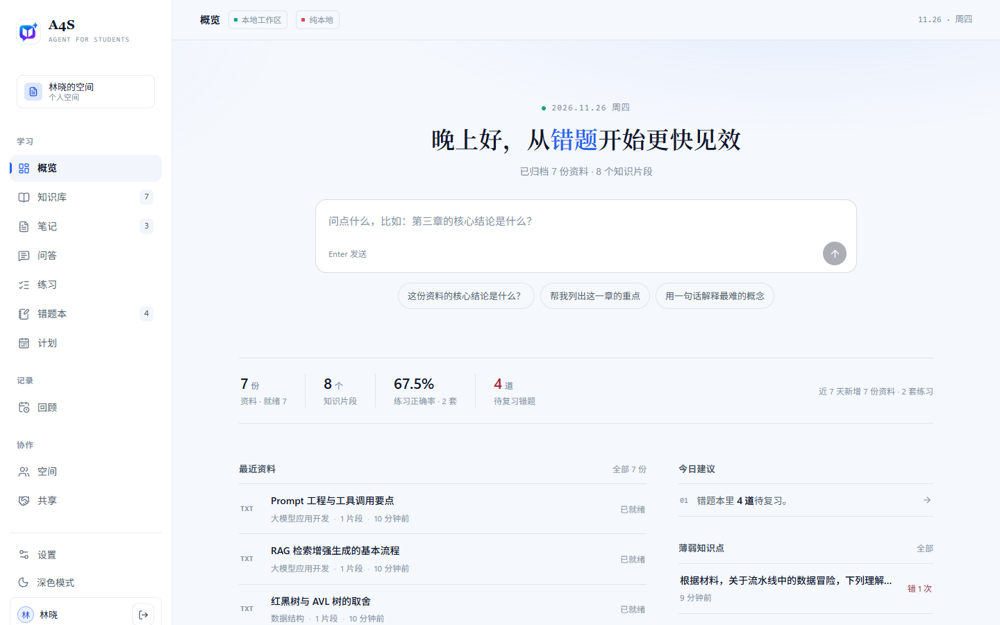
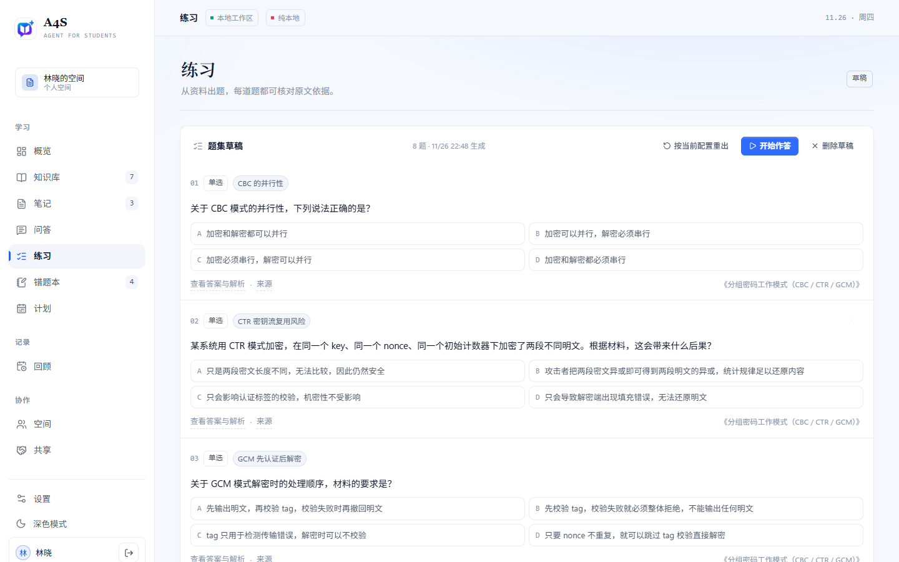
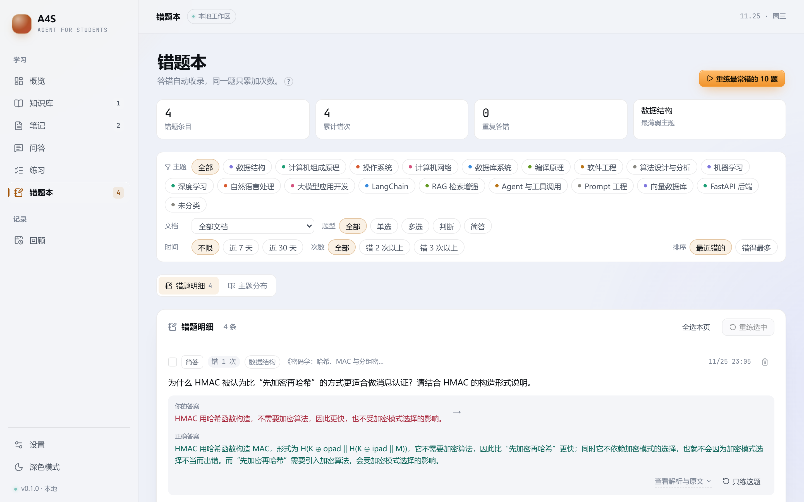

# A4S · Agent For Students

面向大学生的**个人学习助手**：把课程资料变成可问答、可出题、可回顾的知识底座。

全部数据留在本机——资料、笔记、练习、报告都写进本地 SQLite，只有调用模型时才会联网。

> 本项目按 **SDD（规约驱动开发）** 推进：先写规约再写代码，实现与规约冲突时先改规约。
> - **想读代码**：`docs/CODE_MAP.md`（先看这张地图，一小时建立全局认知）
> - 产品规约：`docs/PRD.md`｜任务清单：`docs/TASKS.md`｜逐模块详解：`docs/BACKEND_CODE_GUIDE.md`
> - 架构取舍（为什么这里不用 Agent）：`docs/AGENT_DECISION.md`
> - v0.1 已完成 **145 / 145** 项，13 条 P0 需求全部通过（验收表见 PRD §10）。



---

## 能做什么

| 能力 | 说明 |
|---|---|
| **资料入库** | PDF / Word / Markdown / 纯文本；必选主题；网页正文抓取；失败会给出具体原因 |
| **检索与问答** | 向量 + 全文双路召回，回答带来源角标，可点开原文片段；检索不到时不拿无关片段硬答，
先声明"没有找到相关资料"，再用通用知识补一个回答，并标明"未使用你的资料"；
每段回答下方常显 AI 生成声明，标出关联了几个片段、有没有标注引用 |
| **电子笔记** | 从检索结果起草，模板固定结构（提纲 / 概念 / 代码 / 公式），草稿→定稿两态，AI 补写有标记 |
| **检测题** | 单选 / 多选 / 判断 / 简答四种题型，按主题或按资料出题，每题附解析与来源 |
| **作答与判分** | 客观题自动判分，简答题自评；支持断点续答、自动保存、未答提醒 |
| **错题本** | 答错自动收录，按题目去重累加次数；按主题 / 资料 / 题型 / 时间筛选；勾选重练 |
| **回顾报告** | 聚合 7 / 14 / 30 天的资料与练习，按主题分组输出五个部分：新增资料、练习情况、错题整理、薄弱点、复习建议 |
| **定时与邮件** | 每周定时生成报告并发到邮箱；可关闭；失败会记录原因并在界面提示 |
| **可配置** | LLM / Embedding / SMTP 全部可在界面配置，密钥打码显示，支持「测试连接」与「发送测试邮件」 |

## 界面

| 知识库 | 练习 |
|---|---|
|  |  |

| 错题本 | 回顾 |
|---|---|
|  |  |

深色主题：


> 视觉上只做两件事：**面板是实心的**（层次靠底色差与 1px 描边，不叠玻璃），
> **解释性文字收进标题旁的小问号**（点开才展开，首屏留给数据）。
> 正文 14.5px、元信息不低于 12px，长时间阅读不费眼。

## 技术栈

| 层 | 选型 |
|---|---|
| 前端 | React 18 + TypeScript + Vite + react-markdown（KaTeX / 代码高亮） |
| 后端 | Python 3.11+ / FastAPI / SQLAlchemy 2 / Alembic |
| 关系库 | SQLite（`sqlite3` 单文件，可切 PostgreSQL） |
| 全文检索 | SQLite FTS5 |
| 向量库 | sqlite-vec（SQLite 扩展，无独立服务进程） |
| 模型 | LLM 走 OpenAI 兼容 API；Embedding 默认本地 BGE |
| 调度 | APScheduler（进程内，无系统级计划任务） |

## 环境要求

- Python **3.11+**（在 3.13 验证）
- Node.js **18+**（在 22 验证）
- Windows / macOS / Linux，脚本示例为 Windows

## 安装

```bash
# 1. 后端
cd backend
python -m venv .venv
.venv/Scripts/python.exe -m pip install -r requirements.txt      # 核心依赖
.venv/Scripts/python.exe -m pip install -r requirements-rag.txt  # RAG 依赖（含 torch，约 2GB，首次较慢）

# 2. 前端
cd ../frontend
npm install
```

## 配置

复制 `.env.example` 为 `.env`。最小可用配置只需 LLM 三项：

```ini
LLM_PROVIDER=deepseek
LLM_BASE_URL=https://api.deepseek.com/v1
LLM_API_KEY=你的密钥
LLM_MODEL=deepseek-chat
```

其余可全部省略，之后在「设置」页里配。配置优先级：**`.env` < 界面保存的值**，界面保存会写回 `.env`，重启后仍生效。

密钥只存在本地 `.env`，已列入 `.gitignore`，界面展示时打码（`sk-***abc`）。

## 启动

**方式一（推荐）**：双击项目根的 `start.bat`，自动拉起前后端并打开浏览器。

**方式二（手动）**：

```bash
# 终端 1：后端
cd backend
.venv/Scripts/python.exe -m uvicorn app.main:app --reload --port 8000

# 终端 2：前端
cd frontend
npm run dev
```

- 前端 http://localhost:5173
- 接口文档 http://127.0.0.1:8000/docs
- 健康检查 http://127.0.0.1:8000/api/health

> 若 8000 端口被占用，uvicorn 会以 10048 静默退出。先 `netstat -ano | findstr :8000` 找 PID，再 `taskkill /F /PID <pid>`。

## 五分钟上手

1. **建主题**：进「知识库」，首次会提示从预置包一键创建（计算机核心 / AI 与大模型），也可以自己建。
2. **导入资料**：拖入 PDF 或粘贴文本，必须选主题——主题是后续出题、错题统计、报告分组的最小单位。
3. **问一句**：进「问答」，问资料里的事。回答下方有来源角标，点开可看原文片段。
4. **做题**：进「练习」，选范围与题型数量，生成后作答。交卷即出分数与逐题回顾。
5. **看回顾**：进「回顾」选 7 天点生成。报告会告诉你哪块最弱、下一步先补什么。

## 目录结构

```
backend/app/
├── api/                 # 12 个路由模块：收请求、发响应，不写业务
├── schemas/             # 出入参（Pydantic），前后端的契约
├── domain/              # 业务对象（dataclass + 枚举），不依赖框架
├── services/            # 业务规则：入库/索引/笔记/问答/练习/判分/回顾
├── repositories/        # 数据存取（一张表一个文件），SQL 只在这里
├── infrastructure/      # 外部能力：db / llm / parsers / generators / mail / scheduler
└── main.py              # 启动：迁移 → 种子 → 挂调度
frontend/src/
├── api/client.ts        # 全部接口封装
├── components/          # ui 基础件 + kb / notes / practice 业务组件
├── pages/               # 概览 / 知识库 / 笔记 / 问答 / 练习 / 错题本 / 回顾 / 设置
└── styles/              # tokens.css（令牌）+ pages.css（页面）
```

> 每个目录具体管什么、一个请求怎么流过去，见 **[docs/CODE_MAP.md](./docs/CODE_MAP.md)**。

## 可替换能力

不做插件机制。每类能力由**一个工厂函数**构造，配置决定走哪个分支，业务代码不 import 具体类：

| 能力 | 工厂函数 | 现有实现 |
|---|---|---|
| 对话模型 | `build_llm()` | `deepseek` / `qwen` / `openai` / `moonshot`（全走 OpenAI 兼容协议） |
| 向量化 | `build_embedding()` | 本地 BGE（`local`/`bge`）/ 云端 API（`cloud`/`openai`） |
| 文档解析 | `resolve_parser(ext)` | PDF / DOCX / Markdown / 纯文本 |
| 出题 | `LLMTypedGenerator(type)` | 单选 / 多选 / 判断 / 简答 |
| 邮件推送 | `build_notifier()` | SMTP |

`/api/health` 的 `extensions` 字段会直接回显各扩展点的已注册键。

## 测试

每个里程碑都有独立冒烟脚本，跑在各自的临时库上，不碰开发库：

```bash
cd backend
.venv/Scripts/python.exe scripts/smoke_m2.py    # 资料入库与索引
.venv/Scripts/python.exe scripts/smoke_m3.py    # 问答与笔记
.venv/Scripts/python.exe scripts/smoke_m4.py    # 出题
.venv/Scripts/python.exe scripts/smoke_m4b.py   # 作答判分与错题本
.venv/Scripts/python.exe scripts/smoke_m5.py    # 回顾报告与定时推送
```

`smoke_m5.py` 覆盖 50 项断言：空库提示性报告、时间窗过滤、数字与库一致、模型降级、邮件失败不丢报告、调度启停。

## 数据库迁移

开发环境启动时自动执行 `alembic upgrade head`。新增迁移：

```bash
cd backend
.venv/Scripts/alembic revision --autogenerate -m "描述"
.venv/Scripts/alembic upgrade head
```

切换 PostgreSQL 只需改 `.env` 的 `DATABASE_URL`，业务代码不动（仓储层已做方言隔离）。

## 常见问题

**Q：`/api/health` 里 `llm_configured: false`？**
`.env` 没填 `LLM_API_KEY`。填完重启后端，或直接在「设置」页填并点「测试连接」。

**Q：出题 / 生成回顾很慢？**
它们都在等模型。出题约 20~60 秒（走后台任务 + 轮询），回顾约 10~30 秒（同步返回，界面有明确的生成中状态）。模型慢不是卡死，别重复点。

**Q：生成回顾报「材料不足」？**
出题有下限：题目数 × 100 字，不够会直接告诉你「现有 X 字 / 需要 Y 字」，不会降级出烂题。加资料或减题量即可。

**Q：邮件发不出去？**
先用「发送测试邮件」，它会真的发一封。常见原因：用了登录密码而不是 **SMTP 授权码**；465 端口要开 SSL、587 端口要关 SSL 走 STARTTLS。失败原因会写在提示里，报告不会丢。

**Q：定时任务关机后会补发吗？**
不会。v0.1 不注册系统计划任务，应用未运行时不会触发（补发列为 P1）。想在启动时立刻补一份，去「回顾」点「立即跑一次」。

**Q：换 Embedding 模型后检索结果不对？**
维度不一致时索引会失效。设置页会提示，并在「索引」里提供重建入口，重建会重新向量化全部片段。

## 已知限制

- **扫描版 PDF 无 OCR**：纯图片 PDF 解析出来是空的，会明确报错而不是塞进空片段。
- **简答题不自动判分**：只看自评「掌握 / 未掌握」。本地模型判主观题不可靠，宁可不判。
- **单机单用户**：没有账号体系，`user_id` 固定为 `local`，多人共用一台机器会看到彼此的数据。
- **笔记不回灌知识库**：笔记是学习产物，不参与检索，避免「自己写的话被当成资料引用」。
- **定时任务不持久**：进程内调度，重启后按配置重新装载，关机期间不补发。
- **模型输出需容错**：所有解析路径都有校验（来源编号白名单、答案归一化、JSON 容错），但极端情况下可能少出几道题。

## 版本状态

v0.1.0 · 本地工作区 · 145/145 项完成，PRD 第 10 章 13 条 P0 全部通过。

后续迭代方向（不在 v0.1 范围）：OCR、多用户、移动端、笔记回灌、补发机制、题型自定义。
