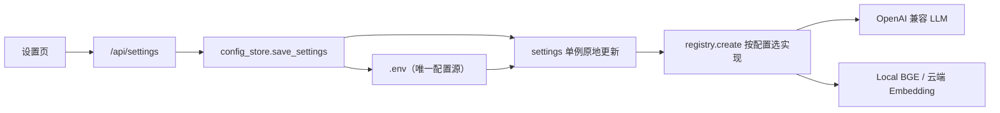
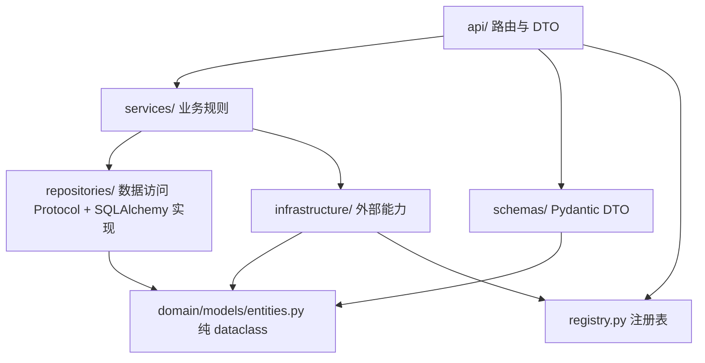
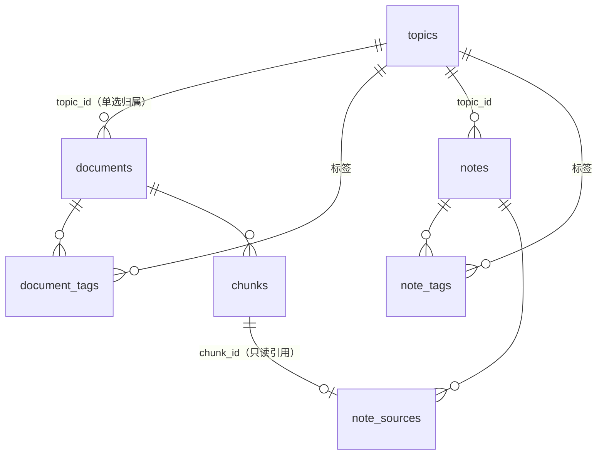
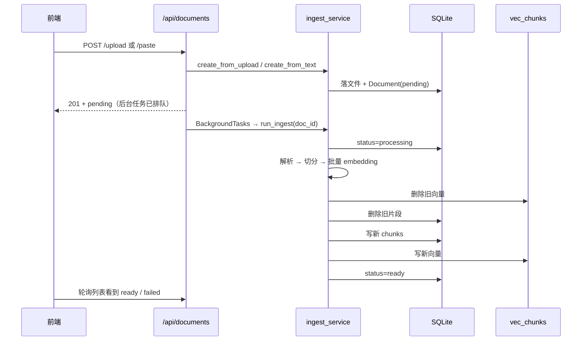
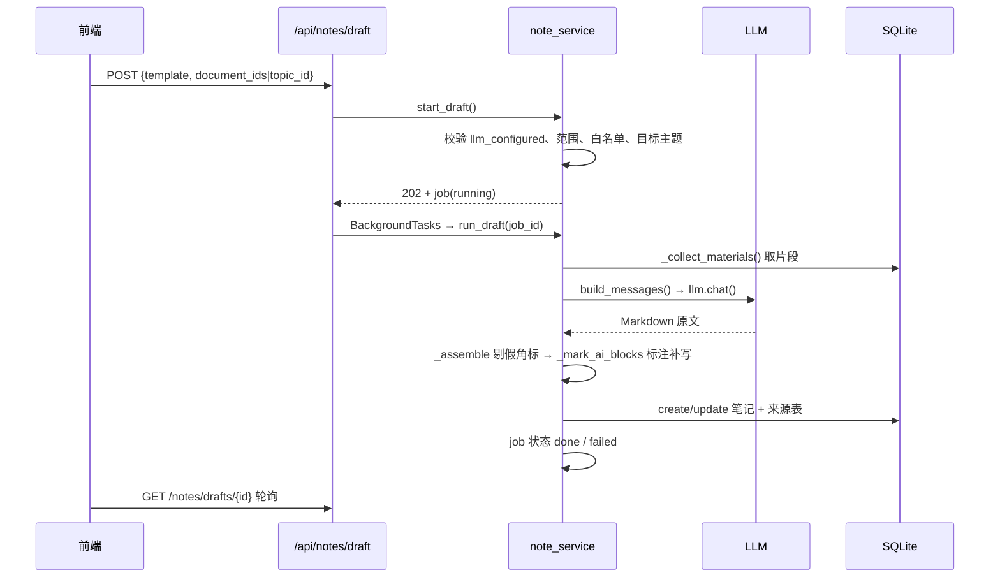

# A4S 后端设计与代码导览（历史存档）

> ⚠️ **这份文档已过时，不要照着它读代码。**
>
> 内容停在 M3（2026-11-25 上午）。此后代码有两处重大变化，本文未同步：
> 1. M4 / M5 新增了练习、判分、错题本、回顾报告、定时推送，本文完全没有。
> 2. v0.1 收尾时删除了插件注册表（`registry.py` / `bootstrap.py`）与
>    `repositories/base.py`，本文§2、§3 围绕它们展开的说明已不成立。
>
> **要读代码请用**：`docs/CODE_MAP.md`（先看，一小时能建立全局认知）→
> `docs/BACKEND_CODE_GUIDE.md`（逐模块详解，与代码同步）。
> 本文仅保留作「早期设计取舍」的参考。

---

> 存档时间：2026-11-25（M3 完成后更新）｜ 对应版本：v0.1.0 ｜ 完成度：M1 + M2 + M2.5 + M2.7 + M3
>
> 本文面向"接下来接手后端的人"：先讲设计意图，再给出代码落点。行号会随改动漂移，因此以**文件名 + 函数/类名**定位。


---

## 1. 一页总览

| 维度        | 选择                                                |
| --------- | ------------------------------------------------- |
| Web 框架    | FastAPI 0.115 + Pydantic v2                       |
| ORM / 迁移  | SQLAlchemy 2.0 + Alembic（启动时自动 `upgrade head`）    |
| 关系库       | SQLite（`backend/data/app.db`），配置层预留 PostgreSQL    |
| 向量库       | `sqlite-vec` 的 `vec0` 虚表，与关系库同文件                  |
| 全文检索      | SQLite FTS5 虚表，中文按字切分 + 短语查询                      |
| LLM       | OpenAI 兼容协议（DeepSeek / 通义 / OpenAI / Moonshot 预设） |
| Embedding | 本地 BGE-small-zh-v1.5（默认），或云端 OpenAI 兼容端点          |
| 异步        | 资料处理 / 笔记起草 / 索引重建用 `BackgroundTasks`，任务状态在进程内字典  |
| 扩展机制      | 六个注册表（Registry），业务代码只依赖端口和键名                      |

**一句话架构**：API 层只做校验与 DTO 转换，业务规则集中在 `services/`，数据访问走 `repositories/`，外部能力（LLM、Embedding、解析、向量库、邮件、出题）藏在 `infrastructure/` 并通过 `app/registry.py` 注册；领域dataclass 与 ORM、DTO 三者刻意分开。

启动：

```bash
cd backend
.venv/Scripts/python.exe -m uvicorn app.main:app --host 127.0.0.1 --port 8000
```

健康检查 `GET /api/health`，接口文档 `/docs`。

---

## 2. 启动流程与配置

### 2.1 lifespan 的顺序不能乱

`app/main.py` 的 `lifespan` 依次做四件事：

1. `register_builtin_extensions()` —— 导入实现模块，靠装饰器注册六个扩展点；
2. 创建 `backend/data/uploads` 目录；
3. `init_db()` —— Alembic 迁移到 head，失败时回退 `create_all`；
4. `ensure_builtin(db)` —— 插入内置的「未分类」主题，因为 `documents.topic_id` 的默认值指向它。

随后挂载 `api_router` 到 `/api`。CORS 只放行 `localhost:5173` 与 `127.0.0.1:5173`，对应本地 Vite 前端。

### 2.2 配置是单一源

`app/config.py` 用 `pydantic_settings` 读取项目根 `.env`，导出全局单例 `settings`。三处细节：

- `resolved_database_url` 把 `sqlite:///./data/app.db` 解析成相对 `backend/` 的绝对路径，避免启动目录不同就找不到库；
- `HF_ENDPOINT` 在 config 模块加载时就写进环境变量——`huggingface_hub` 把它读成模块级常量，晚设无效；
- `llm_configured` / `smtp_configured` 提供"能力是否可用"的布尔判断，业务层据此给出人话错误，而不是堆栈。

`app/infrastructure/config_store.py` 负责把设置页的改动写回 `.env`：保序替换、保留注释和未知键；打码值（含 `***`）一律忽略，避免把 `sk-***abc` 写回配置；`__CLEAR__` 是显式清空密钥的信号；写完**原地更新 `settings` 单例**，无需重启。可写字段白名单不含 `DATABASE_URL`（改了要重启，不开放热改）。

### 2.3 配置模块关系



---

## 3. 分层与扩展点

### 3.1 依赖方向



各层边界：

| 层    | 目录                              | 职责                                 | 不做的事                 |
| ---- | ------------------------------- | ---------------------------------- | -------------------- |
| 接口   | `app/api/`                      | 路由、参数校验、异常→HTTP 码、DTO 组装           | 不写业务规则、不拼复杂 SQL      |
| 应用   | `app/services/`                 | 状态机、任务编排、输出清洗、跨仓储协调                | 不直接写 SQL、不依赖 FastAPI |
| 领域   | `app/domain/models/entities.py` | 纯 dataclass 与枚举，统一语言               | 不依赖框架、不持久化自己         |
| 仓储   | `app/repositories/`             | ORM↔领域对象转换、CRUD、筛选、批量关联替换          | 不承载业务判断              |
| 基础设施 | `app/infrastructure/`           | 解析器、切分、LLM、Embedding、向量库、FTS、配置、邮件 | 不被业务层直接 import 具体实现  |

`repositories/base.py` 定义了仓储 Protocol。当前 API 层直接实例化 SQLAlchemy 实现（通过 `Depends(get_db)` 注入 Session），协议更多是给未来替换存储留的契约。

### 3.2 六个扩展点

`app/registry.py` 是一个泛型 `Registry[T]`，提供 `register(key)` 装饰器、`get(key)`、`create(key, **kwargs)`。六个实例：

| 注册表                  | 已注册实现                                                                       | 端口定义                                      |
| -------------------- | --------------------------------------------------------------------------- | ----------------------------------------- |
| `LLM_REGISTRY`       | `openai` / `deepseek` / `qwen` / `moonshot` → 同一个 `OpenAICompatibleLLM`     | `infrastructure/llm/base.py::LLMProvider` |
| `EMBEDDING_REGISTRY` | `local` / `bge` → `LocalBgeEmbedding`；`cloud` / `openai` → `CloudEmbedding` | 同文件 `EmbeddingProvider`                   |
| `PARSER_REGISTRY`    | `pdf` / `docx` / `markdown` / `text`                                        | `infrastructure/parsers/base.py`          |
| `GENERATOR_REGISTRY` | 空，M4 出题器预留                                                                  | `infrastructure/generators/base.py`       |
| `NOTIFIER_REGISTRY`  | 空，M5 邮件预留                                                                   | `infrastructure/mail/base.py`             |
| `RENDERER_REGISTRY`  | 空，预留                                                                        | —                                         |

业务侧只写 `build_llm()` / `build_embedding()` / `resolve_parser(ext)`；切换供应商改配置即可。`OpenAICompatibleLLM` 一个类注册四个键，因为这几家都提供 OpenAI 兼容端点，只为 base_url 和默认模型不同准备了一份 `LLM_PRESETS`。

---

## 4. 数据模型

### 4.1 ER 关系



ORM 定义在 `app/infrastructure/db/models.py`；Alembic 初始迁移 `migrations/versions/9fdd17ddd198_initial_schema.py` 已包含全部业务表（含 notes 系列）。另外两张**不在 ORM 里**的虚表：

- `vec_chunks`：`sqlite-vec` 的 `vec0`，列是 `chunk_id / embedding FLOAT[512] / topic_id partition key`；
- `notes_fts`：FTS5，列是 `note_id UNINDEXED / title / body`，启动时由 `infrastructure/db/fts.py::ensure_schema` 创建。

### 4.2 几个关键设计

|                                                                                                           |                                                                   |
| --------------------------------------------------------------------------------------------------------- | ----------------------------------------------------------------- |
| **主题与标签同表异构**（`topics.kind`）：主题是单选归属，存外键 `documents.topic_id` / `notes.topic_id`；标签是多选切面，存关联表 \`(document | note)\_tags`。主题删除时 `topic_service\` 会把资料和笔记迁到「未分类」；资料迁移必须同步搬向量分区。 |

**片段冗余存 `topic_id`**（`chunks.topic_id`）：不是从 `documents` join 出来，而是作为 `vec0` 的 partition key 写进向量表。这样按主题检索是在分区内取 Top-K，而不是"全库取 K 再过滤"——后者在小分区上会严重召回不足。代价是改主题要同步三处：文档行、片段行、向量分区。

**笔记来源存快照而非外键**：`note_sources(note_id, chunk_id, document_id, snippet)`，没有外键约束到 chunks。资料删掉后来源记录仍在（snippet 快照还在），但文档名 outer join 不到，`missing=true`，前端显示「来源已删除」而不是报错。`snippet` 只存 240 字用于抽屉预览，完整原文走 `GET /notes/{id}/sources/{chunk_id}` 现查。

---

## 5. 核心链路一：资料入库

### 5.1 时序



入口在 `app/api/documents.py`。上传与粘贴都立即可返回，`BackgroundTasks.add_task(run_ingest, doc_id)` 排队；`run_ingest` **自己开 Session**，避免跨线程复用请求会话。失败走 `except → status=failed + error[:500]`，错误文案直接给前端展示。

### 5.2 三个值得记住的实现点

1. **粘贴文本也落成 `.txt`**（`create_from_text`）：解析、重跑、删除、溯源因此只有一条路径，不用为"无文件资料"写分支。
2. **重新处理是幂等的**（`_process`）：写之前先按 `document_id` 取旧 chunk id，删向量、删片段，再写新的。顺序是先向量后关系库；删除链路 `delete_document` 反过来：向量 → 片段/关联 → 文档 → 原始文件。
3. **解析器按 `supports()` 挑，不按注册表键直接取**（`resolve_parser`）：遍历 `PARSER_REGISTRY.keys()` 实例化后问 `supports(ext)`，因此新增解析器无需改调用方。`builtin.py` 里 PDF 用 pypdf（扫描版明确提示不支持 OCR），DOCX 会把表格按行拼进正文，MD/TXT 按 utf-8-sig → utf-8 → gb18030 依次尝试编码。

切分器 `infrastructure/splitters/text_splitter.py` 是纯函数：先按空行分段，段落超长再按 `。！？；` 切，仍超长硬切；贪心合并到目标 800 字（下限 500、上限 1000），相邻片段重叠 150 字。单元上限会先扣掉重叠空间，否则"重叠 + 满格单元"必然超限。有分页时逐页切并记 `page`。

### 5.3 主题迁移与索引健康

`move_document_topic()` 改 `documents.topic_id` + `chunks.topic_id`，再调 `SqliteVecStore.repartition()`：vec0 不支持原地改 partition key，但可以把向量读回、删除、按新分区插回去，**不需要重新 embedding**。

`services/index_service.py` 只回答两件事：索引还能不能用、要重建怎么重建。

- `index_status()` 对比配置维度、实际索引维度、向量条数与片段条数，给出 `needs_rebuild` 和可读原因；
- `run_rebuild()` 用一条探针文本实测模型维度，若与配置不符就回写 `.env`，再 `store.reset()` 后分页重算。**不重新解析原文件**——片段正文已在 `chunks` 表，重新解析会引入切分差异、还会冲掉用户改过的主题归属；
- 维度不一致时 `store.add()` / `store.search()` 直接抛 `VecDimensionMismatch`，入库链路由此给出"请先在设置中重建索引"，而不是悄悄写入错误向量。

---

## 6. 核心链路二：电子笔记（FR-13）

### 6.1 三条铁律

`services/note_service.py` 开头就写明了，所有改动都要守住：

1. **两阶段**：AI 生成的是 `draft`，人工确认后才 `confirmed`；定稿后任何标题或正文改动都退回 `draft` 并清空 `confirmed_at`。
2. **可溯源**：正文里的 `[[chunk:<id>]]` 必须与 `note_sources` 双向一致；不存在的 id 从正文剔除，宁可少一个角标也不给假出处。
3. **AI 补写留痕**：没有来源的内容块尾部加 \`\`，前端高亮并统计 `ai_written_count`。

### 6.2 角标双向校验的两条路径

| 路径        | 函数                                               | 允许范围                      |
| --------- | ------------------------------------------------ | ------------------------- |
| AI 起草     | `_assemble(raw, allowed)` + `_sources_from(...)` | 只信本次起草白名单 `allowed` 里的 id |
| 手工创建 / 编辑 | `_resolve_cites(db, markdown)`                   | 以片段是否真实存在为准               |

`create()` 和 `update()`（仅当正文变化时）都会调 `_resolve_cites`：存在的 id 补进来源表，编造的从正文剔除。**只改标题不动来源**，避免无关编辑重建关联。

这里踩过一个真 bug：写入后 API 直接序列化内存中的 `Note`，而 `document_name` 是仓储 outer join 出来的，内存对象上没有，于是前端把每条来源都判成"来源已删除"。修法是 `create()` / `update()` 结尾统一 `return repo.get(note.id) or note` 回读一次。

### 6.3 起草任务



- **任务状态是进程内字典** `_JOBS`，只保留最近 20 个；`_public(job)` 过滤掉 `_` 开头的内部载荷（片段原文不进接口）。
- 上下文预算：最多 24 个片段、每篇资料最多 6 个、总计 14000 字符；超出即停。
- `note_prompts.py` 把四种模板骨架写死在代码里（章节摘要 / 概念卡 / 代码笔记 / 公式清单），原因见文件头注释：稳定结构才能对比、重生成才不会每次换形状。`SYSTEM_PROMPT` 要求每个要点带角标、补写段落以 \`\` 结尾。
- `run_draft` 是 `async`，因为 LLM 调用是异步的；它同样自己开 Session。失败原因经 `_explain()` 转成"鉴权失败（401）""额度不足（429）"等人话。
- 重新整理必须带 `?confirm=true`，否则 400——防止覆盖正文误触。

### 6.4 列表摘要与搜索

`app/api/notes.py::_excerpt()` 是列表摘要的清洗规则：删标题行、代码块、表格行、分隔线、角标、AI 标记；公式只留内容去 `$`；列表项之间插 `·`。搜索命中位置超过 1/3 时把截取窗口挪到命中处，否则用户只看到一屏无关内容。前端用 `<Highlight>` 包住命中的词，`components.css` 里给了琥珀底 + 继承色的 `mark` 样式。

搜索本身在仓储层：`SqlAlchemyNoteRepository.list()` 优先走 FTS5，不可用时降级 `LIKE`。`infrastructure/db/fts.py` 的 `char_split()` 把汉字逐字用空格分开（FTS5 的 `unicode61` 会把连续汉字当一个 token，搜「索引」永远不命中），查询时再用短语查询要求字符连续；`bm25(notes_fts, 4.0, 1.0)` 让标题权重高于正文。FTS 行由笔记仓储在 add/update/delete 时**同一事务**维护，杜绝"笔记删了索引还在"。

### 6.5 接口清单

| 方法     | 路径                                   | 说明                                                   |
| ------ | ------------------------------------ | ---------------------------------------------------- |
| GET    | `/api/notes`                         | 列表，支持 `topic_ids` / `tag_ids` / `status` / `keyword` |
| POST   | `/api/notes`                         | 手工新建（正文可写角标）                                         |
| GET    | `/api/notes/templates`               | 四种起草模板的 key / label / hint                           |
| GET    | `/api/notes/{id}`                    | 详情，含 sources                                         |
| PATCH  | `/api/notes/{id}`                    | 更新；改正文会重算来源并可能退回草稿                                   |
| POST   | `/api/notes/{id}/confirm`            | 确认定稿                                                 |
| DELETE | `/api/notes/{id}`                    | 删除笔记，不动来源资料                                          |
| POST   | `/api/notes/draft`                   | 异步起草，202 + job                                       |
| POST   | `/api/notes/{id}/regenerate`         | 重新整理，需 `confirm=true`                                |
| GET    | `/api/notes/drafts/{job_id}`         | 轮询任务状态                                               |
| GET    | `/api/notes/{id}/sources/{chunk_id}` | 取完整原文片段                                              |

---

## 7. 设置与能力体检


`app/api/settings.py` 提供三类能力：

- `GET/PUT /api/settings`：配置快照（密钥打码、数据库 URL 隐藏密码）与写回；改了 embedding 配置会顺带返回索引状态；
- `GET /api/settings/index`、`POST /api/settings/index/rebuild`：索引状态与后台重建；
|  |  |  |
| --- | --- | --- |
- `POST /api/settings/test`：`target = llm | embedding | smtp` 的连通性测试。测试时用 `merged_values()` 合并"当前配置 + 界面临时覆盖值"，**不写盘**，因此用户可以在保存前试。LLM 的 401 / 404 / 429 / timeout 都被翻译成针对性强的人话。

注意 `save_settings` 改完配置后，`get_vector_store()` 会检测 `embedding_dimension` 变化并重建单例——否则它会拿旧维度去比对真实索引，得出错误结论。

---

## 8. 代码地图

| 目录 / 文件 | 看什么 |
|---|---|
| `app/main.py` | lifespan、CORS、路由挂载 |
| `app/config.py` | 全部环境变量、路径解析、能力布尔判断 |
| `app/registry.py` | 六个扩展点，`Registry` 泛型 |
| `app/bootstrap.py` | 内置实现注册入口（导入即触发装饰器） |
| `app/domain/models/entities.py` | 全部业务概念与枚举，统一语言 |
| `app/schemas/` | Pydantic 请求 / 响应 DTO |
| `app/api/router.py` | 路由聚合清单 |
| `app/api/documents.py` | 上传 / 粘贴 / 批量改归属 / 重新处理 / 片段列表 |
| `app/api/notes.py` | 笔记全部接口 + `_excerpt` 摘要清洗 + 导出 |
| `app/api/chat.py` | 问答 SSE 端点 |
| `app/api/topics.py` | 主题 / 标签 CRUD + 主题包套用 |
| `app/api/settings.py` | 配置读写、连通性测试、索引维护 |
| `app/services/ingest_service.py` | 入库流水线、删除顺序、主题迁移 |
| `app/services/index_service.py` | 索引健康与重建任务 |
| `app/services/note_service.py` | 笔记状态机、角标校验、起草任务、输出清洗 |
| `app/services/note_prompts.py` | 四种模板骨架与输出契约 |
| `app/services/chat_service.py` | M3 检索 + SSE 问答 |
| `app/services/chat_prompts.py` | 问答提示词契约 |
| `app/services/webfetch_service.py` | 网页导入的 URL 校验与错误人话化 |
| `app/infrastructure/webfetch.py` | httpx 抓取 + trafilatura 转 Markdown |
| `app/services/topic_service.py` | 主题保护、冲突、删除迁移 |
| `app/repositories/sqlalchemy_repo.py` | ORM↔领域转换、筛选、批量关联替换、FTS 同步 |
| `app/repositories/stats_repo.py` | 首页聚合 |
| `app/infrastructure/db/session.py` | engine / Session / 迁移 / 向量库与 FTS 开关 |
| `app/infrastructure/db/models.py` | 业务表 ORM 定义 |
| `app/infrastructure/db/fts.py` | FTS5 虚表、中文按字切分、bm25 查询 |
| `app/infrastructure/vectorstore/sqlite_vec_store.py` | vec0 建表、写入、删除、分区搬移、Top-K 检索 |
| `app/infrastructure/llm/` | LLM / Embedding 端口与实现 |
| `app/infrastructure/parsers/builtin.py` | PDF / DOCX / MD / TXT 解析器 |
| `app/infrastructure/splitters/text_splitter.py` | 中文友好的切分策略（纯函数） |
| `app/infrastructure/config_store.py` | `.env` 保序写入、打码与即时生效 |
| `app/infrastructure/db/seed.py` | 内置主题与主题包 |
| `migrations/versions/*.py` | 初始 schema |
| `scripts/smoke_m2.py` / `smoke_m25.py` | 端到端冒烟测试 |

---

## 9. 设计取舍与踩过的坑

这些不是理论，是这一路真出过的问题，改之前先看一眼：

1. **FTS 必须按字切中文**：`unicode61` 把"向量索引"当一个 token，直接 MATCH「索引」永远为 0；按字拆成"向 量 索 引"并用短语查询才既支持单字又不误命中。
2. **FTS / 索引与业务行同事务**：由仓储在 add/update/delete 里同步维护，不能靠定时补偿，否则搜索会先于索引反映删除。
3. **写操作后回读**：`document_name` 是 join 出来的派生字段，内存对象没有；create/update 不回读就会把有效来源误判成"已删除"。
4. **改主题要搬向量分区**：三处（documents / chunks / vec_chunks）必须同步，只改一处会导致按主题检索静默漏数据。
5. **vec0 不能原地改 partition key**：0.1.9 会报 unsupported；读回向量 → 删除 → 按新分区插回，无需重做 embedding。
6. **维度以实测为准**：配置里的 `embedding_dimension` 是手填的；重建时先算探针向量回写配置，避免"配置描述事实"变成"配置决定事实"。
7. **主题行 chip 的 flex 收缩**：前端踩坑，但后端数据量大时会放大——19 个主题必须单行横滑且 chip `flex: none`，否则被压成竖排文字。
8. **首屏包膨胀**：KaTeX / Markdown 渲染器不能进主包，笔记编辑器按需加载（前端约定，后端接口不受影响）。
9. **后台任务跨线程别复用 Session**：`run_ingest` / `run_draft` / `run_rebuild` 都自己 `SessionLocal()` 并在 finally 关闭。
10. **任务状态进程内**：服务重启会丢失 running 中的任务与任务历史，这是 v0.1 的已知限制，不是 bug；M3 若要持久化应另起一张 job 表。
11. **同名正则不同 pattern 是隐患**：`api/notes.py` 的 `_MARK` 与 `services/note_service.py` 的 `_MARK` 长得一样，但前者原本无捕获组（只用来删匹配）。导出功能在 api 层用 `group(1)` 时炸了 `IndexError: no such group`。修法是给 api 版补上捕获组——但根因是"两处各自定义同名常量"，最好收敛成一处。
12. **lazy 页面新增时要检查重依赖**：Chat 页接 MarkdownView 后如果静态 import，主包从 265 kB 涨回 897 kB。新增页面的判断标准：它是否 import 了 `components/notes/MarkdownView` 或其他带 KaTeX 的组件。

---

## 10. M3 的接入点（已于 2026-11-25 完成）

以下原计划的接入点全部落地，实现与预想基本一致；差异点标注在括号里。

| 能力 | 位置 | 状态 |
|---|---|---|
| LLM 流式输出 | `infrastructure/llm/openai_compat.py::OpenAICompatibleLLM.stream()` | ✅ 接入 `/api/chat` SSE |
| 向量 Top-K 检索（含主题分区、白名单过滤） | `infrastructure/vectorstore/sqlite_vec_store.py::search()` | ✅ 接入 `chat_service.retrieve()`（未单独封装 Retriever 类，直接对接，与 ADR-09 一致） |
| Embedding 单例 | `infrastructure/llm/bge_local.py::build_embedding()` | ✅ |
| 来源定位数据结构 | `domain/models/entities.py::SourceRef` | 未使用：问答引用直接用 dict + `schemas/chat.py::CitationOut`，结构与 NoteSource 对齐 |
| 片段查询接口 | `GET /api/documents/{id}/chunks` | ✅ |
| 范围筛选（主题 / 标签） | `SqlAlchemyChunkRepository.list_by_topic()` 等 | ✅ 主题走分区键、标签/资料走白名单 |
| 笔记来源深链 | `GET /notes/{id}?source=<chunk_id>` | ✅ 「存为笔记」还原 `[[chunk:id]]` 后复用 |

---

## 11. M3 补充（2026-11-25）：问答链路与两个增量功能

### 11.1 RAG 问答（FR-03）

核心文件：`services/chat_service.py`（检索 + SSE）、`services/chat_prompts.py`（提示词契约）、`api/chat.py`（SSE 端点）、`schemas/chat.py`。

- **单请求 SSE**：`POST /api/chat` 一次完成检索与生成，事件顺序固定：`sources`（引用先行下发，前端先渲染来源卡片）→ `delta…` → `done`；`no_context`（范围内无相关内容，不调模型）、`error` 兜底。SSE 用 `StreamingResponse` + `X-Accel-Buffering: no` 防网关缓冲。
- **范围过滤两条路径**：`topic_id` 走 vec0 partition key（分区内取 Top-K）；`tag_ids`/`document_ids` 无法下推，先查片段白名单再 `allowed_chunk_ids` 过滤（store 内部 4 倍超采再截断）。两者同时给定时取交集。
- **相似度阈值**：sqlite-vec 返回 cosine distance，`相似度 = 1 - distance`，阈值 0.3；低于阈值的命中直接丢弃，宁可"没找到"也不让模型对无关片段硬答。
- **多轮**：前端传最近对话，`_trim_history()` 只留 5 轮且首条必须是 user；no_context/error 的轮次不进历史（前端过滤）。
- **存为笔记**：前端把回答里的 `[n]` 还原成 `[[chunk:id]]` 后调 `POST /api/notes`（`source_type='chat'`），来源表由既有双向校验接管——问答与笔记两条链路在这里闭环。

### 11.2 网页导入（FR-01 扩展）

核心文件：`infrastructure/webfetch.py`（httpx 抓取 + trafilatura 正文提取转 Markdown）、`services/webfetch_service.py`（URL 校验与错误人话化）、`POST /api/documents/webfetch`。

- **只做预览不入库**：返回 title + markdown，前端在「导入资料」弹窗里填进"粘贴文本"表单，用户可编辑后点保存——入库复用 `/paste`，解析/切分/向量化仍是唯一一条路径，没有为网页引入第二种数据形态。
- **边界**：仅 http/https；PDF 明确提示改走文件上传；5 MB / 20s 上限；提取正文 < 200 字视为失败（大概率是 JS 渲染页），提示改用粘贴导入。
- 前端入口：知识库导入弹窗第三个 tab「网页」，`?upload=web` 深链直达。

### 11.3 笔记导出（FR-13 扩展）

`GET /api/notes/{id}/export`（`api/notes.py::_export_markdown`）：`[[chunk:uuid]]` 按 `note_sources` 顺序转成 `[1]`/`[2]`，文末追加 `## 来源` 清单（文档名，已删除的来源如实标注）；正文无一级标题时补 `# 笔记标题`。`Content-Disposition` 用 `filename*=UTF-8''` 携带中文名。前端编辑页「导出」按钮先落库再 blob 下载，保证导出的是当前内容。

### 11.4 冒烟测试

`scripts/smoke_m3.py` 25 项断言：空库兜底、未配 Key、真实切分与向量化、分区/标签/资料三种范围过滤、历史裁剪、假模型跑通 SSE 全链路、`source_type='chat'` 落库。`--real` 参数追加真实 LLM 流式验证（需先配 API Key）。

---

## 12. 验证与运维

```bash
# 后端冒烟（会创建临时库，不影响 data/app.db）
cd backend
.venv/Scripts/python.exe scripts/smoke_m2.py
.venv/Scripts/python.exe scripts/smoke_m25.py   # 46 项断言，含角标双向校验、命中处摘要、中文单字搜索
.venv/Scripts/python.exe scripts/smoke_m3.py    # 25 项断言；--real 追加真实 LLM 流式（需配 Key）

# 前端类型检查与构建
cd frontend
npx tsc --noEmit
npm run build
```

现场服务地址：后端 `http://127.0.0.1:8000`，前端 `http://localhost:5173`。数据都在 `backend/data/`：`app.db`（业务 + 向量 + FTS 一张文件）、`uploads/YYYY/MM/<uuid>.<ext>`（原始文件）。备份只要复制 `backend/data/` 整个目录。

**已知限制**：未配置 LLM 时起草返回"尚未配置大模型 API Key，请先在设置页填写"（降级路径已验证）；扫描版 PDF 无 OCR；`sqlite-vec` 不可用时向量检索关闭，需在设置里看到明确提示；邮件与调度、出题器尚未实现（`practice` / `review` / `schedule` 是占位接口）。
